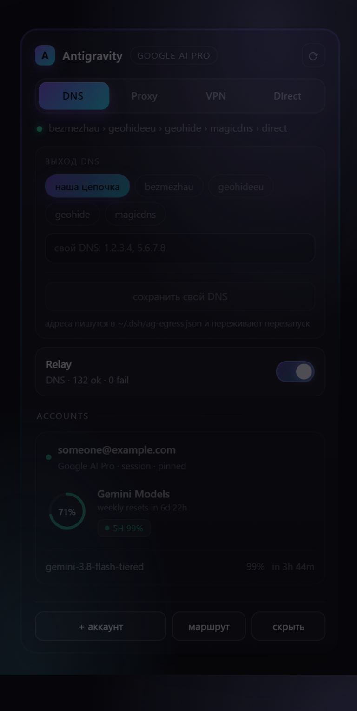
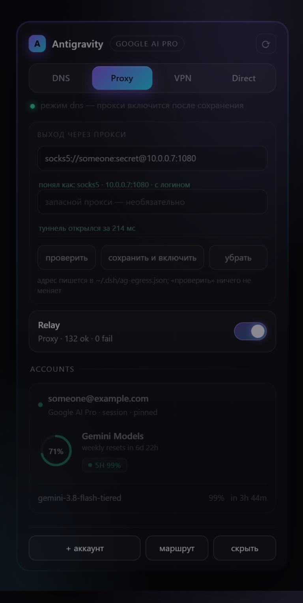

# dsh-plugin-quota-overlay

A quota panel for the DSH shell: every account, both Google windows, and the transport switch —
in one card in the corner. No chat commands; every action is a button.

<p align="center">
  
  
</p>

## What it shows

**Weekly and five-hour, per group.** Google meters Cloud Code on two windows at once, and they
fail differently: five hours is a short cut-off that slides forward, a week is a long one that
does not. Each group the account has — `Gemini Models`, `Claude and GPT models` — gets a ring with
the weekly percentage left, the reset countdown, and a small `5H` badge for the short window.

**Per model, underneath.** The five-hour number for the models you actually use, worst first.
This is what answers "why did it just refuse" without opening a second window.

**The transport.** Four modes — `DNS`, `Proxy`, `VPN`, `Direct` — as one segmented control. The
line under it is the truth, not the intent: the channel chain in DNS mode, the masked address in
proxy mode, the detected tunnel in VPN mode, and an explicit "not configured" when a mode cannot
work. Details in [docs/transports.md](../../docs/transports.md).

**A relay switch.** One tap between the current mode and `direct`, and back to the mode you came
from. It is the same thing as the segmented control, sized for a thumb.

**Accounts.** Which is pinned (served first), which is a session, which is dead and why. `pin`
reorders the pool; `add account` starts the OAuth flow in a new tab.

## Motion

The panel steps in rather than blinking in: a short rise on open, a shorter fall on close, the
mode thumb slides between segments, rings draw themselves from zero, account cards cascade in,
and the status line cross-fades when the text changes. Everything is CSS — no animation library,
no layout thrash — and `prefers-reduced-motion` turns all of it off.

## Requirements

- the bridge on `127.0.0.1:8787` (`~/.dsh/bridge/bridge.js`);
- the egress shim on `127.0.0.1:8789`, started by the same `bridge.js`;
- Node 20+.

The plugin supervises the bridge itself: it adopts a healthy instance, spawns `bridge.js` when
nothing answers, restarts it with backoff, and stops it on dispose. Write mode `vpn` or `direct`
and it stops trying to revive a WARP proxy — those are not its to fix.

## Install

```bash
cp -r plugins/quota-overlay ~/.dsh/profiles/web/plugins/
```

```yaml
# ~/.dsh/profiles/web/cordis.patch.yml
- insert:
    - id: quota-overlay
      name: "./plugins/quota-overlay/index.js"
```

Then restart the shell. The full walkthrough, including credentials and transports, is
[docs/plugin-install.md](../../docs/plugin-install.md).

## Config

| Env | Default | Meaning |
| --- | --- | --- |
| `AG_BRIDGE_DIR` | `~/.dsh/bridge` | folder holding `bridge.js` |
| `AG_BRIDGE_URL` | `http://127.0.0.1:8787` | bridge base URL |
| `AG_EGRESS_URL` | `http://127.0.0.1:8789` | egress shim base URL |
| `AG_BRIDGE_SECRET` | `local-bridge` | bearer the bridge accepts; **change it** |
| `AG_EGRESS_FILE` | `~/.dsh/ag-egress.json` | routing config the supervisor reads |
| `WARP_CLI` | `warp-cli` | resolved through `PATH`; only used for the search tunnel |

Profile config wins over the environment:

```yaml
      config: { bridgeUrl: "http://127.0.0.1:8787", egressUrl: "http://127.0.0.1:8789", bridgeSecret: "local-bridge" }
```

## Panel design

The stylesheet lives in `client.js` as one string, so there is nothing to build and nothing to
serve separately. A preview can be generated without a browser extension:

```bash
node preview/build-preview.mjs   # writes preview/preview.html from the same CSS the overlay uses
```

That file exists so spacing and contrast can be checked in a plain browser instead of guessing in
the dark. `assets/panel-dns.png` and `assets/panel-proxy.png` are screenshots of it, built by `preview/build-preview.mjs`.